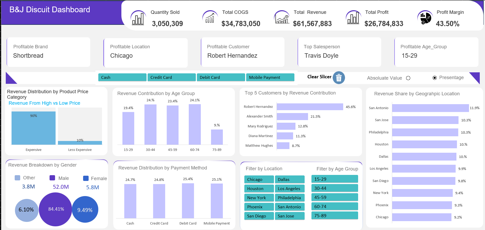

# Sales Performance & Profitability Analysis

### Turning Sales Data into Business Insights & Better Decisions

A business-focused data analysis project aimed at evaluating sales performance, profitability, product pricing, customer behavior, and revenue distribution.

---

## 📌 Project Overview

This project analyzes sales data to understand overall business performance and identify the key factors driving revenue and profitability.

The analysis focuses on product pricing, customer segments, geographical performance, payment methods, and customer revenue contribution.

The main goal is not just to visualize sales data, but to extract meaningful business insights that can support strategic decisions and improve business performance.

## 🎯 Business Objectives

- Evaluate overall sales and profitability performance.
- Identify the most profitable customer age groups.
- Analyze revenue contribution across different product price segments.
- Identify the highest-performing cities.
- Understand revenue distribution across payment methods.
- Identify key customers contributing significantly to total revenue.
- Provide actionable recommendations to support business growth.

## 📊 Key Performance Indicators (KPIs)

| KPI | Result |
|:---|---:|
| Total Revenue | $61.5M+ |
| Total Profit | $26.7M |
| Profit Margin | 43.5% |

## 🔍 Key Business Insights

### 1. Revenue & Profitability

- Total revenue exceeded **$61.5 million**.
- Total profit reached approximately **$26.7 million**.
- Overall profit margin reached **43.5%**.

These results provide an overview of the business's financial performance.

### 2. Customer Age Group Analysis

- Customers aged **15–29** represented the most profitable age group.
- This segment could be an important target for future marketing strategies.

### 3. Geographical Performance

- **San Antonio** generated the highest revenue contribution among the analyzed cities.
- This highlights an important geographical market that businesses could focus on when planning expansion and marketing activities.

### 4. Product Pricing Analysis

One of the most interesting findings was the relationship between product pricing and revenue contribution.

- High-priced products generated approximately **90% of total revenue**.
- Low-priced products contributed only around **10%**.

This finding challenges the assumption that lower-priced products always generate higher sales value.

### 5. Payment Method Analysis

- Revenue was distributed relatively evenly across different payment methods.
- This suggests that customers use multiple payment options rather than relying heavily on a single payment method.

### 6. Customer Revenue Contribution

- A relatively small group of customers contributed a significant share of total revenue.
- This highlights the importance of identifying high-value customers and developing effective customer retention strategies.

## 💡 Business Recommendations

Based on the analysis, the following actions could help improve business performance:

- **Focus on High-Value Products:** Maintain the availability of high-priced products and evaluate opportunities to improve their profitability.
- **Target Profitable Segments:** Develop targeted marketing campaigns for customers aged 15–29.
- **Strengthen Key Markets:** Explore growth opportunities in San Antonio based on its strong revenue contribution.
- **Retain Valuable Customers:** Develop loyalty programs and personalized offers for high-value customers.
- **Maintain Payment Flexibility:** Continue supporting multiple payment methods to provide a convenient purchasing experience.
- **Monitor Profitability:** Track profit margins across products and customer segments to identify opportunities for improvement.

## 🛠️ Tools & Technologies

- **Power BI:** Interactive dashboard development and data visualization.
- **DAX:** Business calculations and performance metrics.
- **Data Analysis:** Exploring sales patterns, customer behavior, and business performance.

## 📈 Project Dashboard

<!-- Sales Performance Dashboard Screenshots -->

<## 📈 Project Dashboard & Data Analysis

### Main Sales Dashboard

  

### Pivot Table Analysis

  

  

## 📌 Conclusion

This project demonstrates how sales data can reveal important business opportunities beyond traditional sales reporting.

The analysis highlights the importance of understanding not only how much a business sells, but also which products, customers, and markets contribute the most to its financial performance.

**The real value of data analytics is turning numbers into insights, and insights into better business decisions.**

---

**Sales Performance & Profitability Analysis | Data Analytics Portfolio Project**

